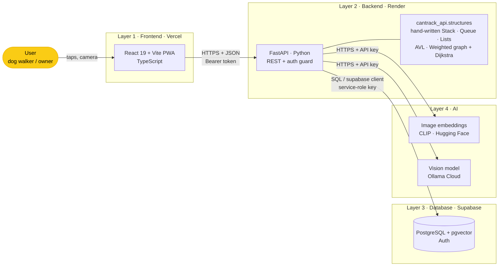
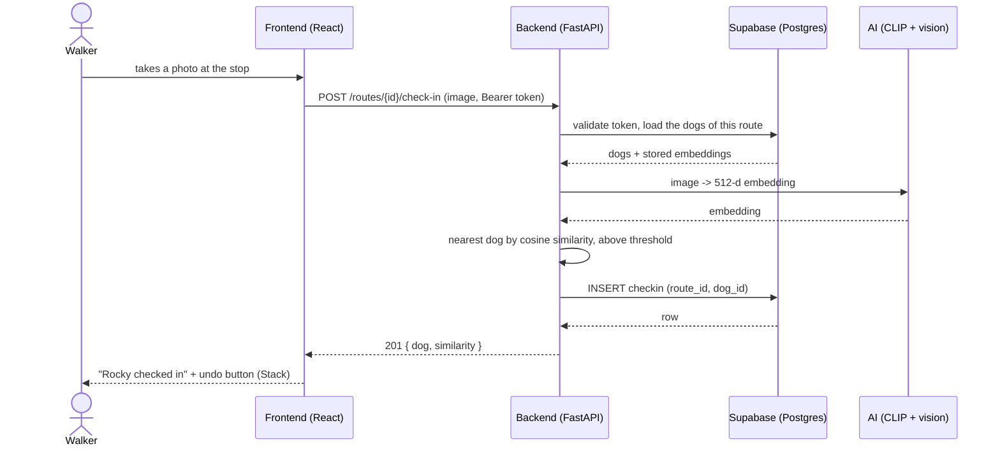
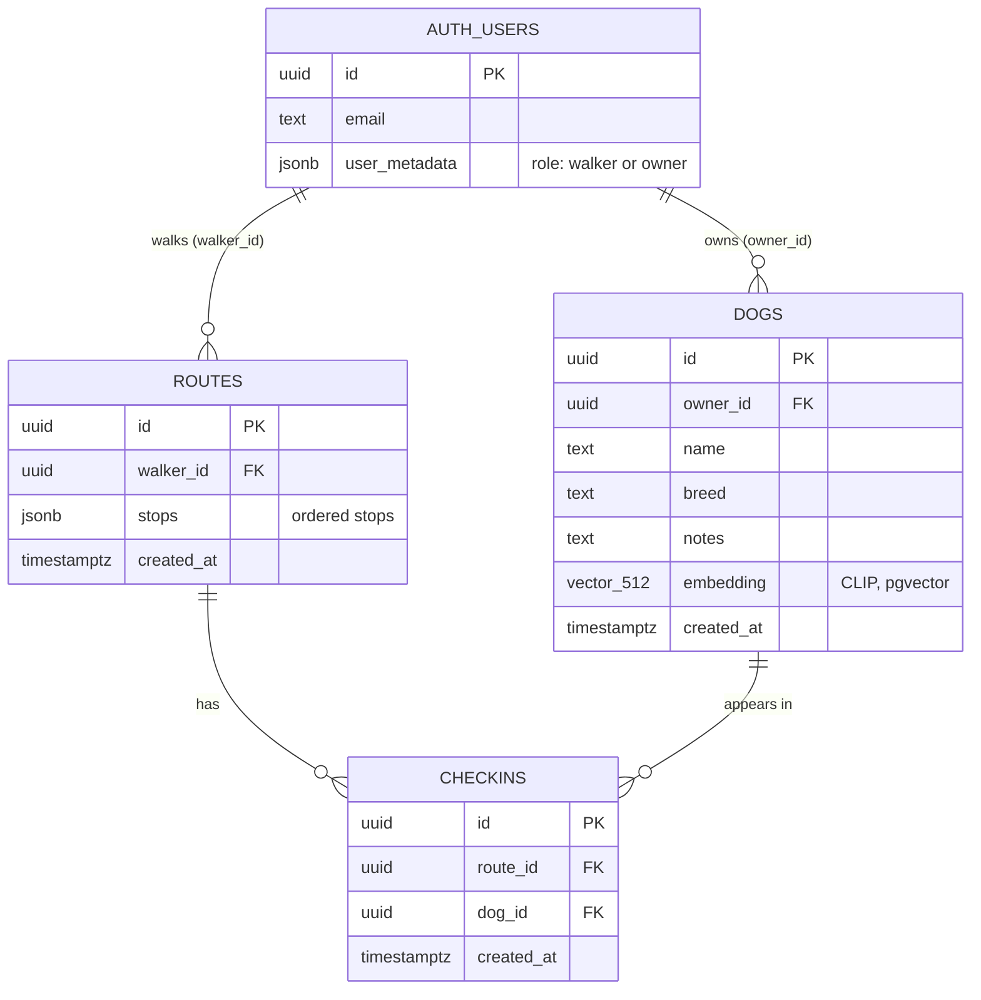

# CanTrack — Architecture

Four layers, each in its own stack. The frontend only talks to the backend; the backend is the
only layer that talks to the database and to the AI models, and the only one that holds secrets.

Secrets (`SUPABASE_SERVICE_ROLE_KEY`, `HF_TOKEN`, `OLLAMA_API_KEY`) live in the backend `.env`
(git-ignored). The browser never sees them and never calls the AI or the database directly.

## Request journey: a walker checks a dog in

## Entity-relationship diagram

Source of truth for the schema: `apps/api/schema.sql`.

## Where each data structure lives

| Structure | Used for |
|---|---|
| Stack | undo history of check-ins |
| Queue | GPS ingestion buffer |
| Singly linked list | ordered stops of a route (reorder / remove) |
| Doubly linked list | walk timeline, navigable both ways |
| Circular list | recurring route rotation |
| AVL tree | next pickup by time, O(log n) |
| Weighted graph + Dijkstra | shortest path through the street mesh |
